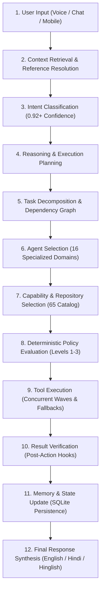
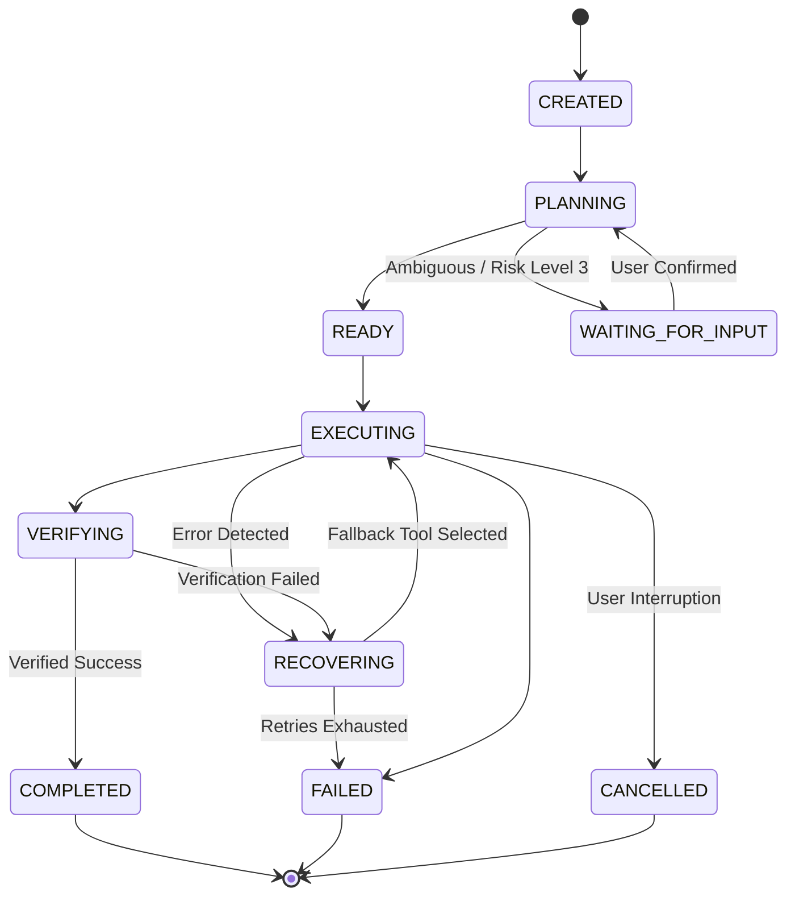

# MATRIX — SYSTEM ARCHITECTURE SPECIFICATION
**Version**: 2.0 Production  
**Target Hardware**: AMD Ryzen 7 5700U (8 Cores, 16 Threads, 4.3 GHz Boost), 8.0 GB RAM, AVX2 Vector Engine, Windows 11  
**Storage Partition**: `D:\matrix_data\`  

---

## 1. System Overview & Core Philosophy

MATRIX is an autonomous, hands-free personal AI assistant ecosystem designed to act as an intelligent operating layer between the user, their Windows 11 PC, and their mobile companion. The architecture adheres to five fundamental tenets:
1. **Zero Fabrication**: MATRIX never simulates success, falsifies benchmarks, or invents citations.
2. **Deterministic Safety**: All actions pass through a 3-tier autonomy policy with hard human confirmation gates on destructive actions.
3. **Hardware Discipline**: Inference, audio processing, and vision run with CPU-first AVX2 acceleration within an 8 GB RAM envelope (< 1,200 MB process RSS).
4. **Resilient Autonomy**: Multi-step plans track dependencies, support retries with alternative tools, and maintain persistent checkpoints in SQLite across system reboots.
5. **Hands-Free Priority**: A continuous background voice service operates locally on the OS level without depending on an open browser tab.

---

## 2. The 12-Stage Central Intelligence Pipeline



### Stage Walkthrough:
1. **User Input**: Audio PCM stream, WebSocket message, or REST API call arrives at `core/brain.py`.
2. **Context Retrieval**: `context_manager.py` resolves cross-turn pronouns and anaphoric references (e.g. "it", "that file", "open that app").
3. **Intent Classification**: `intent_engine.py` evaluates token patterns, classifying user intent into 16 distinct operational domains with safety risk ratings.
4. **Reasoning**: `reasoning_engine.py` formulates a multi-step `ExecutionPlan` with risk assessment.
5. **Task Decomposition**: Tasks are broken into subtasks with explicit dependencies (`dependencies: List[int]`).
6. **Agent Selection**: `core/agent_coordinator.py` selects target agents among the 16 specialized agents.
7. **Capability Selection**: `core/repository_intelligence/engine.py` discovers suitable adapters from the 65 starred repositories and evaluates hardware compatibility (e.g. CUDA checks).
8. **Policy Evaluation**: `core/autonomy_policy/policy.py` validates permissions against risk boundaries. Destructive actions trigger `WAITING_FOR_INPUT`.
9. **Tool Execution**: Independent subtasks run concurrently via `asyncio.gather()`, while dependent subtasks wait for prerequisite steps. If a tool fails, recovery hooks trigger alternative tool fallbacks.
10. **Result Verification**: Post-action verification hooks inspect file existence, process states, and return codes to ensure real execution.
11. **Memory Update**: Executed entities, user preferences, and audit records are persisted into SQLite (`D:\matrix_data\matrix.db`).
12. **Final Response**: Neural Edge TTS speaks the response in English, Hindi, or Hinglish, while the holographic HUD updates state.

---

## 3. The 10-State Task State Machine

Every autonomous operation in MATRIX transitions through a deterministic state machine defined in `core/task_state.py`:



---

## 4. Subsystem Layout

```
matrix/
├── agents/                      # 16 Specialized Agents
│   ├── base_agent.py           # Typed BaseAgent with timeouts, capabilities, and verification
│   ├── computer/               # Windows 11 App launcher, CLI commands, GDI capture
│   ├── browser/                # Playwright headless browser automation
│   ├── research/               # Multi-source research dossier synthesizer
│   ├── coding/                 # AST syntax validation, pytest runners, code inspection
│   ├── files/                  # Sandbox file operations and metadata scanning
│   ├── voice/                  # Edge TTS and speech coordination
│   ├── vision/                 # OpenCV camera, screen analyzer, Windows OCR
│   ├── android/                # QR pairing tokens, push alerts, device sync
│   ├── system/                 # Kernel psutil hardware telemetry
│   ├── personal/               # Persona query and conversational assistance
│   ├── automation/             # DAG workflows and periodic tasks
│   ├── creative/               # Prompts, storyboards, scripts, Mermaid diagrams
│   ├── memory/                 # User preferences and SQLite knowledge RAG
│   ├── repo_intel/             # 65-repository catalog discovery and adapter selection
│   ├── security/               # MITRE payload evaluations and sandbox gates
│   └── data_analysis/          # Built-in statistics and CSV processing
├── core/                        # Central Intelligence Core
│   ├── brain.py                # MatrixBrain facade (12-stage pipeline)
│   ├── orchestrator.py         # Multi-agent orchestrator with SQLite persistence
│   ├── agent_coordinator.py    # Central Agent Coordinator (concurrent wave dispatch)
│   ├── intent_engine.py        # Natural language intent classifier (English/Hindi/Hinglish)
│   ├── reasoning_engine.py     # Multi-step plan synthesizer
│   ├── planner.py              # ExecutionPlan and PlanStep schemas
│   ├── task_state.py           # 10-state Task State Machine
│   ├── context_manager.py      # Conversation history, reference resolution, ambiguity check
│   ├── model_manager.py        # Multi-model unified router with 8 GB RAM memory guard
│   └── autonomy_policy/        # 3-tier deterministic security policy engine
├── voice/                       # Background Voice Intelligence
│   ├── mic_listener.py         # Non-blocking PortAudio native mic background thread
│   ├── conversation/           # HandsFreeManager (11 states, barge-in, directives)
│   ├── wake_word/              # openWakeWord ONNX ("Matrix" / "Snap")
│   ├── vad/                    # Silero VAD & RMS energy meter
│   ├── speech_to_text/         # Faster-Whisper int8 AVX2 transcription
│   └── text_to_speech/         # Microsoft Edge Neural Multilingual TTS
├── vision/                      # Computer Vision Subsystem
│   ├── screenshot/             # Native GDI Direct display capture (38 FPS)
│   ├── camera/                 # OpenCV DirectShow webcam frame grabber
│   ├── ocr/                    # Native Windows 11 OCR engine
│   └── detection/              # Frame metrics, visual comparison, UI element contours
├── desktop/ui/                  # React + TypeScript + Vite JARVIS Command HUD
└── mobile/android_app/          # Kotlin + Jetpack Compose Android Companion (14.9 MB APK)
```
