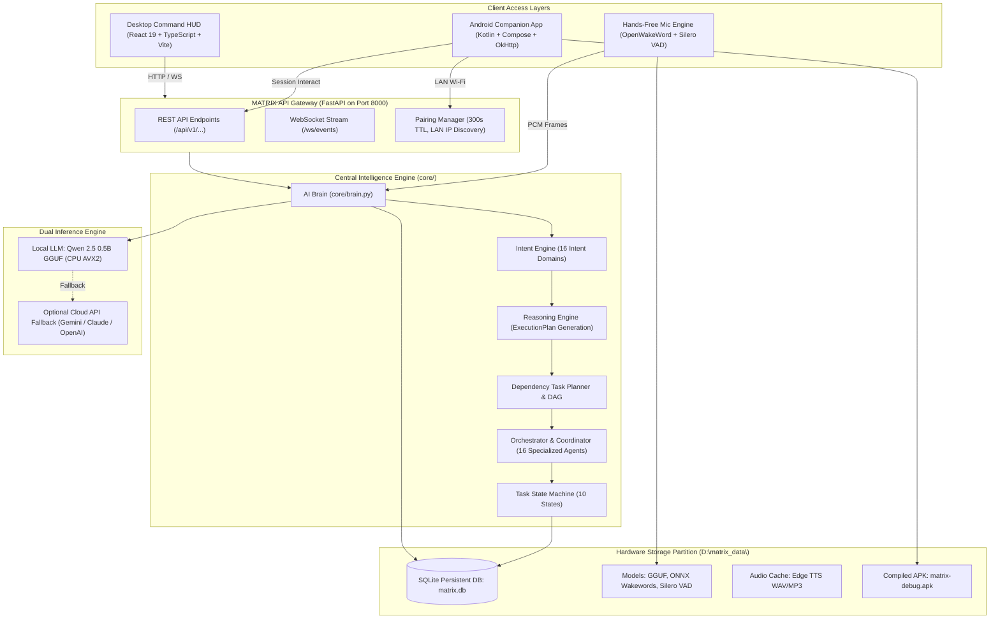
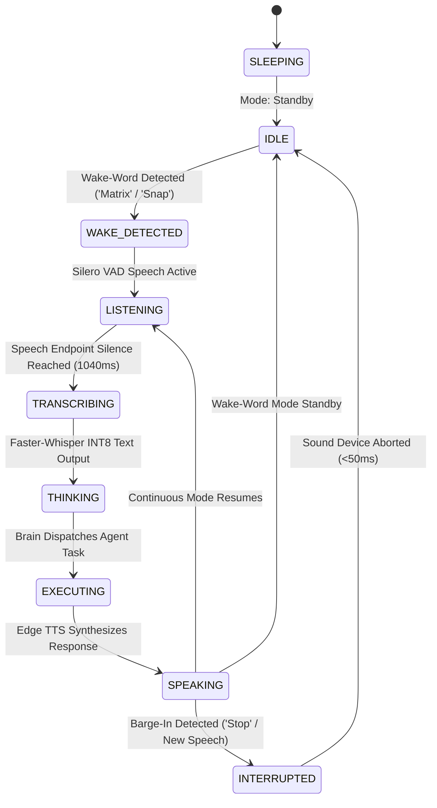
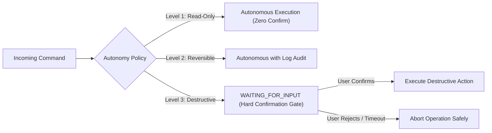

# MATRIX — Complete System Architecture & Component Diagrams

**Version**: 2.0 Production  
**Target Architecture**: AMD Ryzen 7 5700U (8 Cores / 16 Threads, AVX2) • 8 GB RAM • Windows 11 Home  
**Persistent Storage**: `D:\matrix_data\`  
**Gateway**: `0.0.0.0:8000` (Local Desktop + LAN Mobile Bridge)  

---

## 1. Global System Topology

---

## 2. Hands-Free Voice Lifecycle

---

## 3. Autonomy Policy & Security Tier

---

## 4. Cross-Reference Documentation
- [System Architecture Specification](file:///C:/Users/Ali%20Raza%20Zaidi/Desktop/matrix/docs/ARCHITECTURE.md)
- [Master Build Status](file:///C:/Users/Ali%20Raza%20Zaidi/Desktop/matrix/docs/MASTER_BUILD_STATUS.md)
- [Autonomous Operations Manual](file:///C:/Users/Ali%20Raza%20Zaidi/Desktop/matrix/docs/AUTONOMOUS_OPERATIONS_MANUAL.md)
