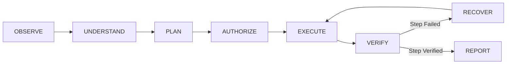

# MATRIX Autonomous Multi-Agent Orchestration & Security System

## 1. Architectural Philosophy

MATRIX is engineered not as a passive chat interface, but as an autonomous personal operating layer. It independently observes user intent, formulates execution plans, selects specialized agents, delegates subtasks, executes tools, verifies results, recovers from transient failures, and synthesizes clear reports.

---

## 2. The 8-Stage Execution Loop

1. **OBSERVE**: Continuously ingests multimodal user input (spoken directives, typed commands, desktop frames, file uploads).
2. **UNDERSTAND**: Intent engine classifies the request across 11 core intent topologies and maps it to primary and secondary candidate agents.
3. **PLAN**: Reasoning engine synthesizes an `ExecutionPlan` containing distinct, sequential steps with tool parameters and risk ratings.
4. **AUTHORIZE**: Policy gate checks the plan's maximum risk level against the active security tier. Safe operations proceed immediately; high-risk operations trigger an explicit authorization prompt.
5. **EXECUTE**: Task router delegates tools to specialized agents with parameter validation.
6. **VERIFY**: Agent results are verified against empirical criteria (HTTP status codes, DOM elements, file sizes, process exits).
7. **RECOVER**: If an action encounters a recoverable error (e.g. search engine challenge or page timeout), the orchestrator executes automatic retry with exponential backoff or alternative tool delegation.
8. **REPORT**: The central response generator synthesizes agent data into a natural conversational summary spoken by MATRIX.

---

## 3. Autonomy vs. Security Policy Gates

MATRIX enforces 4 discrete security tiers:

| Security Level | Description | Behavior | Permitted Actions |
| :---: | :--- | :--- | :--- |
| **Level 1: Passive** | Read-only observation | Auto-executes queries, telemetry, research | Web search, system metrics, file reading |
| **Level 2: Safe Autonomous** | Reversible actions | Auto-executes non-destructive operations | Folder creation, report generation, file organization |
| **Level 3: Sensitive** | Elevated operations | Requires user approval | Installing packages, modifying environment files |
| **Level 4: Critical** | Irreversible / Destructive | **STRICTLY BLOCKED** without explicit confirmation | Deleting root files, formatting drives, wiping databases |

> [!IMPORTANT]
> Destructive commands (such as `del /f /q`, `rmdir /s /q`, `format`, `DROP TABLE`) are intercepted at the Policy Gate and will never execute autonomously under any circumstance.

---

## 4. Checkpoints, Audit Trails & Emergency Stop

- **Audit Checkpoints**: Every planning step, dispatch attempt, and execution outcome is logged into the persistent SQLite database table `audit_logs` at `D:\matrix_data\matrix.db`.
- **Progress Broadcasting**: Active tasks publish real-time step progress events (`TASK_PROGRESS`) over WebSockets to the Command HUD.
- **Emergency Stop**: If an active task needs immediate cessation, saying **"Matrix, stop"** or invoking `orchestrator.cancel_active()` halts execution immediately at the nearest step boundary without leaving dirty locks.
