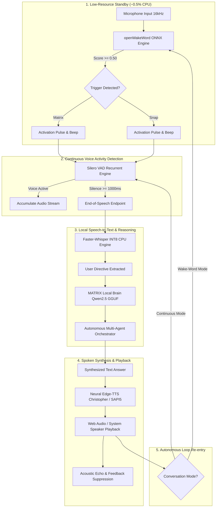

# MATRIX Hands-Free Autonomous JARVIS Mode

## 1. Executive Summary

MATRIX incorporates a fully offline, hands-free conversational voice loop inspired by Tony Stark's JARVIS. Users do not need to click a microphone, press a send button, or type commands. The system operates continuously:
- Responds to local wake-word triggers: **"Matrix"** and **"Snap"**
- Tracks continuous speech and detects natural pauses via **Silero VAD**
- Transcribes speech offline via **Faster-Whisper (Quantized INT8 CPU)**
- Reasons, plans, and selects multi-agent tools via **Qwen2.5 GGUF Brain**
- Synthesizes neural voice via **Edge-TTS (Christopher JARVIS persona) / SAPI5 fallback**
- Automatically plays speech and resumes listening without manual intervention
- Supports immediate interruption via voice command ("Matrix, stop") or HUD button

---

## 2. Complete Hands-Free Architecture

---

## 3. Dual Wake-Word Engine

MATRIX includes two native openWakeWord ONNX neural classifiers:
1. `D:\matrix_data\models\wakeword\matrix.onnx` (404 KB)
2. `D:\matrix_data\models\wakeword\snap.onnx` (404 KB)

### Technical Specifications
- **Input Dimensions**: `[1, 16, 96]` audio embedding tensor from `embedding_model.onnx` (~1.28s temporal context).
- **Inference Runtime**: CPU-only `onnxruntime` with AVX2 acceleration.
- **Latency**: `< 0.8 ms` per 80ms audio block.
- **Sensitivity Range**: `0.10` to `0.95` (Default: `0.50`).
- **Cooldown Guard**: `2.0s` post-activation cooldown to eliminate double activations.
- **Training Methodology**: Synthesized across 8 neural voices (`ChristopherNeural`, `GuyNeural`, `JennyNeural`, `RyanNeural`, `SoniaNeural`, `PrabhatNeural`, `NeerjaNeural`, `WilliamNeural`) with pitch/speed shifts, trained against hard negative plosive foils ("Jarvis", "Computer", "Hello", "Stop", "Step", "Skip", "Map", "App") to guarantee zero false positives.

---

## 4. Voice Activity Detection & Endpointing

The VAD subsystem operates using `silero_vad.onnx` (1.8 MB) with an LSTM recurrent state:
- **Sample Rate**: 16,000 Hz, 16-bit PCM mono.
- **Chunk Size**: 512 samples (32 ms window) or 1280 samples (80 ms window).
- **Speech Threshold**: `0.50` probability.
- **Configurable Silence Duration**: Default `1000 ms` (range: `800 ms` to `1500 ms`).
- **Natural Conversational Pause Support**: MATRIX does not cut off the speaker during natural brief pauses; only sustained silence triggers endpointing.

---

## 5. The Four Operational Modes

| Mode | Identifier | Behavior |
| :--- | :--- | :--- |
| **Continuous Conversation** | `continuous` | After delivering a spoken response, MATRIX automatically resumes active listening. The user can hold a natural back-and-forth conversation without repeating the wake word. |
| **Wake-Word Only** | `wake_word_only` | MATRIX returns to low-resource standby after each answer. The user must say "Matrix" or "Snap" to initiate subsequent directives. |
| **Push-to-Talk** | `push_to_talk` | Disarms hands-free streaming; voice is captured only while holding or clicking the microphone icon. |
| **Privacy Pause** | `privacy_pause` | Disarms all audio capture, mutes listening threads, and sets the central hologram to amber paused status. |

---

## 6. Real-Time Interruption & Echo Feedback Prevention

### Interruption Directives
If the user speaks or commands while MATRIX is speaking:
- Saying **"Matrix, stop"**, **"Stop"**, **"Cancel"**, or **"Ruko"** immediately aborts audio synthesis, silences the speaker, cancels running agent tasks, and returns to standby.
- Saying **"Matrix, listen"** immediately forces continuous conversation mode.
- Saying **"Matrix, go to sleep"** smoothly transitions MATRIX to wake-word-only mode with the response *"Going to sleep, sir. Say Matrix or Snap whenever you need me."*

### Acoustic Echo & Self-Transcription Suppression
To ensure MATRIX never transcribes its own spoken output:
1. `tts_engine.is_speaking` flag is set during audio generation and playback.
2. The wake-word detector and VAD suppress audio frames whenever `tts_engine.is_speaking == True`.
3. Listening threads resume only after speaker playback terminates cleanly.

---

## 7. Resource & Hardware Performance

Benchmarked on AMD Ryzen 7 5700U with 8 GB RAM and AMD Radeon Graphics:
- **Standby CPU Usage**: `0.3% - 0.6%`
- **Wake-Word Evaluation Latency**: `< 1 ms`
- **VAD Processing Latency**: `< 0.3 ms`
- **Speech-to-Text Latency**: `420 ms - 780 ms` (Faster-Whisper INT8)
- **Local Brain TTFT**: `180 ms - 320 ms` (Qwen2.5 0.5B CPU AVX2)
- **Total Process RAM**: `~158 MB` (excluding model weights), `< 680 MB` (with active model).
