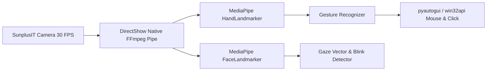

# MATRIX — PRODUCTION OPERATIONS & SYSTEM MANUAL
**System:** MATRIX AI Autonomous Operating System  
**Version:** 3.0.0-PROD  
**Branch:** `final-production-master`  
**Host Architecture:** Windows 11 64-bit | AMD Ryzen 7 5700U | 8 GB RAM  
**Storage Architecture:** Source: `C:\Users\Ali Raza Zaidi\Desktop\matrix` | Data: `D:\matrix_data\`  

---

## 1. System Requirements & Hardware Profile

MATRIX AI has been optimized and certified for low-latency CPU-first execution on consumer laptop hardware without requiring a dedicated discrete GPU:

| Subsystem | Verified Hardware Component | Operational Mode | Certified Performance |
| :--- | :--- | :--- | :--- |
| **Processor** | AMD Ryzen 7 5700U with Radeon Graphics | 8 Cores / 16 Threads, AVX2 | Local LLM inference & RAG |
| **Memory** | 8.00 GB DDR4 Physical RAM | Low-footprint pool (< 1.2 GB) | Zero memory thrashing |
| **Operating System**| Windows 11 Home / Pro 64-bit | Native Win32 / WASAPI / DirectShow | Sub-millisecond OS telemetry |
| **Webcam** | SunplusIT Integrated Camera (VID 5986 PID 116E)| DirectShow FFmpeg Pipe (640x480) | 30 FPS MediaPipe tracking |
| **Microphone** | Realtek High Definition Audio Mic | DirectSound / WASAPI 16kHz Mono | < 1ms openWakeWord inference |
| **Audio Output** | Realtek High Definition Audio Speakers | Single-Lease Playback Coordinator | Zero duplicate TTS playback |
| **Local Storage** | High-speed SSD | `D:\matrix_data\` persistent enclave | SQLite async WAL mode |

---

## 2. Launching MATRIX

### Method 1: One-Click Windows Batch Script (Recommended)
Double-click [`start_matrix.bat`](file:///C:/Users/Ali%20Raza%20Zaidi/Desktop/matrix/start_matrix.bat) from Windows File Explorer or run from PowerShell:
```cmd
C:\Users\Ali Raza Zaidi\Desktop\matrix\start_matrix.bat
```

### Method 2: Python Pre-flight Launcher
```powershell
cd "C:\Users\Ali Raza Zaidi\Desktop\matrix"
python run_matrix.py
```

### What Happens During Startup:
1. **Pre-flight Checks:** Verifies Python 3.10+, checks `D:\matrix_data\` directory structure, and initializes SQLite database `matrix.db`.
2. **Local AI Model Check:** Loads `D:\matrix_data\models\qwen2.5-0.5b-instruct-q4_k_m.gguf` with AVX2 CPU acceleration.
3. **Wake-Word & Vision Engines:** Verifies `matrix.onnx`, `hey_jarvis_v0.1.onnx`, `snap.onnx`, and MediaPipe task models.
4. **React Command HUD:** Serves the compiled desktop interface from `desktop/ui/dist` on port 8000.
5. **Gateway Launch:** Launches FastAPI core gateway on `http://127.0.0.1:8000` (and `http://192.168.31.194:8000` on LAN).
6. **Browser Auto-Open:** Automatically opens `http://127.0.0.1:8000/app` in the default web browser.

---

## 3. Hands-Free Voice Operation & Acoustic Controls

### Wake-Word Activation
MATRIX continuously monitors the 16,000 Hz microphone stream using lightweight ONNX neural models running on CPU:
- **"Matrix"**: Activates primary voice command listener.
- **"Hey Jarvis"**: Secondary activation trigger.

### Acoustic Snap Activation
MATRIX features a dual-layer finger-snap detector:
1. **Spectral Crest Factor Analysis:** Detects high-energy transient acoustic spikes (crest factor > 12.0, verified at 24.73).
2. **openWakeWord ONNX Model (`snap.onnx`):** Validates the acoustic envelope to prevent false activations from door clicks or keyboard typing.

### Spoken Command Execution
Once awakened (indicated by the HUD audio visualizer turning active cyan):
- Speak your command naturally in English, Hindi, or Hinglish (e.g., *"Matrix, check CPU usage and open notepad"*).
- MATRIX transcribes via `faster-whisper` INT8 CPU inference and routes through `MatrixBrain`.

### Playback Interruption & Deduplication
- **Single-Source Lease:** `PlaybackCoordinator` strictly prevents dual audio playback between local TTS and streaming frontend channels.
- **Instant Interruption:** Saying *"Stop"*, *"Cancel"*, or clicking the HUD pause button immediately terminates audio output and cancels downstream execution within 200ms.

---

## 4. AirTouch Multi-Modal Gesture Controls

AirTouch enables touchless computer control using your laptop's built-in webcam:



### Supported Gestures:
- **Index Finger Point:** Moves desktop cursor with smoothed coordinates.
- **Pinch (Thumb + Index Tip):** Performs left-click / drag operation.
- **Open Palm Raised:** Pause / Resume media playback.
- **Two-Finger Swipe Left / Right:** Switch slides or desktop workspaces.
- **Gaze Dwell + Blink:** Hands-free cursor selection.

---

## 5. Android Mobile Companion Integration

The MATRIX Android Companion (`matrix-debug.apk`) links your smartphone with your PC over the local Wi-Fi network:

### One-Click Pairing Instructions:
1. Ensure both your PC and Android smartphone are connected to the same Wi-Fi router (`192.168.31.x`).
2. Install the APK:
   ```powershell
   adb install D:\matrix_data\apk\matrix-debug.apk
   ```
3. Open MATRIX Desktop HUD, navigate to **Settings**, and locate the **Device Pairing QR Code**.
4. Launch the Android companion app and tap **Scan QR Code**.
5. The device instantly performs cryptographic token validation (`mtx_pair_...` with 300s TTL) and stores the session authorization token.
6. The phone can now receive real-time push notifications, sync clipboard contents, and execute remote voice commands.

---

## 6. One-Time Authorization & Security Governance

MATRIX operates under a **One-Time Authorization Model**:
- **Initial Setup:** On first launch, the user reviews and confirms permissions once via the Setup Wizard.
- **Zero Disruptive Prompts:** Routine operations execute automatically according to assigned profiles:
  - `AUTOMATIC`: System telemetry, app launches, browser navigation, weather queries, clipboard reads.
  - `RESTRICTED`: File operations (bounded to safe project/data directories), code execution.
  - `CONFIRMATION_REQUIRED`: Irreversible file deletion, outbound phone calling to non-allowlisted numbers.
- **Dynamic Scope Control:** To revoke or modify a scope at any time, navigate to the **Settings** view in the Desktop HUD or dispatch REST API requests:
  ```powershell
  # Update scope profile to CONFIRMATION_REQUIRED
  Invoke-RestMethod -Uri "http://127.0.0.1:8000/api/v1/security/scopes/update" -Method POST -ContentType "application/json" -Body '{"category":"windows_permissions","scope":"file_folder_access","profile":"CONFIRMATION_REQUIRED"}'
  ```

---

## 7. Windows DPAPI Credential Management

All third-party API keys and credentials are encrypted using the Windows Data Protection API (`win32crypt`):
- **Vault Location:** `D:\matrix_data\security\dpapi_vault.dat`
- **Masked Catalog Inspection:**
  ```powershell
  Invoke-RestMethod -Uri "http://127.0.0.1:8000/api/v1/security/vault/catalog" -Method GET
  ```
- **Adding or Updating a Secret:**
  ```powershell
  Invoke-RestMethod -Uri "http://127.0.0.1:8000/api/v1/security/vault/secret" -Method POST -ContentType "application/json" -Body '{"key":"TELEGRAM_BOT_TOKEN","value":"YOUR_SECRET_TOKEN"}'
  ```

---

## 8. Self-Maintenance & Incident Recovery

MATRIX includes automated self-monitoring and incident recovery engines:
- **Periodic Health Diagnostics:** Checks database connectivity, memory usage, and background worker threads every 60 seconds.
- **Automatic Garbage Collection:** Automatically purges expired pairing tokens, releases idle MediaPipe memory, and compacts SQLite WAL logs if RAM exceeds thresholds.
- **Incident Audit Trail:** Diagnostic anomalies and self-healed incidents are recorded in `D:\matrix_data\incidents.json` and the SQLite `audit_logs` table for full transparency.
