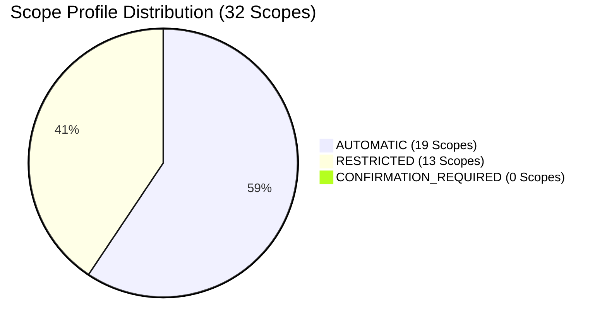

# MATRIX — PERMISSION & CONNECTION REPORT
## One-Time Authorization Center & Windows DPAPI Vault Architecture

## 1. Overview & Objective
The MATRIX One-Time Authorization Center eliminates recurring "Are you sure?" confirmation dialogues during routine operation while establishing an uncompromised security boundary around Windows OS resources, hardware sensors, and cloud services.

Once the initial setup wizard completes, MATRIX operates autonomously within configured permission profiles, requesting supervisor confirmation only for high-risk operations (e.g., permanent deletion of system files, outbound phone calls to unverified numbers).

---

## 2. Windows DPAPI Credential Vault
- **Engine**: Native Windows Data Protection API (`win32crypt.CryptProtectData` and `win32crypt.CryptUnprotectData`).
- **Storage Location**: `D:\matrix_data\security\dpapi_vault.dat`
- **Security Invariant**: API keys and secrets are encrypted with the active Windows user credentials and machine entropy. No master password is stored in source code, configuration files, or environment variables.
- **Auto-Migration**: Upon application initialization, plaintext secrets found in `.env` (such as `BLAND_API_KEY`) are automatically imported into the DPAPI vault, encrypted on disk, and securely retrieved in-memory.

### Stored Vault Secrets:
| Secret Key | Description | Status | Source |
| :--- | :--- | :--- | :--- |
| `BLAND_API_KEY` | Bland AI Telephony Outbound Calling API Key | **SECURE (ENCRYPTED)** | DPAPI Vault |
| `GEMINI_API_KEY` | Google Gemini Multimodal Cloud API Key | **CONFIGURED / LOCAL GGUF FALLBACK** | Local / Vault |
| `TELEGRAM_BOT_TOKEN` | Matrix Telegram Companion Notification Bot | **PENDING USER INPUT** | Vault Catalog |
| `GITHUB_TOKEN` | GitHub Starred Repositories & Octokit Access | **PENDING USER INPUT** | Vault Catalog |

---

## 3. Scope Hierarchy & Profile Distribution
The system governs **32 default permission scopes** divided into 4 primary functional categories:

### Detailed Catalog by Category:

#### A. Windows OS Permissions (12 Scopes)
| Scope Name | Default Profile | Description |
| :--- | :--- | :--- |
| `microphone` | `AUTOMATIC` | Real-time audio capture via default input device for wake-word & STT |
| `camera` | `RESTRICTED` | Camera frame access for AirTouch hand/eye tracking (active only when AirTouch is ON) |
| `screen_capture` | `AUTOMATIC` | Local screen capture for UI reasoning and troubleshooting |
| `ui_automation` | `AUTOMATIC` | Programmatic UI click, scroll, and type operations |
| `keyboard_mouse` | `AUTOMATIC` | Virtual input synthesis for application automation |
| `file_folder_access`| `RESTRICTED` | Unrestricted read in project/data dirs; restricted write in sensitive system paths |
| `app_launch` | `AUTOMATIC` | Launch and terminate approved desktop software and browser windows |
| `system_telemetry` | `AUTOMATIC` | Real-time polling of CPU, RAM, disk, network, and battery status |
| `notifications` | `AUTOMATIC` | Native Windows 11 toast notification dispatch |
| `clipboard_access` | `AUTOMATIC` | Read and write access to Windows clipboard |
| `startup_background_service` | `AUTOMATIC` | Execution as background service on Windows startup |
| `bluetooth_devices`| `RESTRICTED` | Scanning and communication with paired Bluetooth peripherals |

#### B. Connected Services & Cloud APIs (9 Scopes)
| Scope Name | Default Profile | Description |
| :--- | :--- | :--- |
| `google_workspace_oauth` | `RESTRICTED` | Google Workspace OAuth authorization |
| `gmail` | `RESTRICTED` | Read and draft emails (send requires confirmation or allowlist) |
| `google_calendar` | `AUTOMATIC` | Query and schedule calendar events |
| `github` | `RESTRICTED` | Read repositories; push actions restricted to approved branches |
| `telegram` | `AUTOMATIC` | Push alerts and two-way directives via Telegram bot |
| `bland_phone_calling`| `RESTRICTED`| Automated outbound calls restricted to target number `+919193002500` |
| `firebase_notifications`| `AUTOMATIC`| Cloud messaging alerts to Android companion |
| `tailscale_remote_access`| `RESTRICTED`| Encrypted WireGuard remote access across private Tailnet |
| `weather_openmeteo`| `AUTOMATIC`| Public REST meteorological polling |

#### C. Hardware Subsystems (6 Scopes)
| Scope Name | Default Profile | Description |
| :--- | :--- | :--- |
| `laptop_microphone`| `AUTOMATIC` | DirectSound/WASAPI access to Realtek HD Audio Mic |
| `speakers` | `AUTOMATIC` | Single-lease TTS audio playback through default output |
| `webcam` | `RESTRICTED` | RGB video capture for MediaPipe vision models |
| `android_phone` | `AUTOMATIC` | Local-network websocket sync with Matrix Android companion |
| `bluetooth_hardware`| `RESTRICTED`| Hardware BLE adapter access |
| `airtouch_tracking_hardware`| `RESTRICTED`| Hand & eye tracking sensor coordination |

#### D. Repository Adapters & Execution (5 Scopes)
| Scope Name | Default Profile | Description |
| :--- | :--- | :--- |
| `github_starred_repos`| `AUTOMATIC` | Reading and searching 65 repository capabilities |
| `approved_dependency_installation`| `RESTRICTED`| Python `pip` installation restricted to verified requirements |
| `local_model_downloads`| `AUTOMATIC` | Fetching GGUF, ONNX, and Task models into `D:\matrix_data\models` |
| `tool_registration` | `AUTOMATIC` | Dynamic registration of external tool adapters |
| `isolated_execution_environments`| `RESTRICTED`| Spawning subprocesses and sandboxed execution runtimes |

---

## 4. API Endpoints
All authorization operations are exposed via FastAPI under [`api/routes/security.py`](file:///C:/Users/Ali%20Raza%20Zaidi/Desktop/matrix/api/routes/security.py):
- `GET /api/v1/security/authorization-center`: Full status, category groupings, and profile distributions.
- `POST /api/v1/security/setup-wizard`: Executes the one-time setup wizard, establishing default profiles.
- `POST /api/v1/security/scopes/update`: Dynamically changes a scope's profile (`AUTOMATIC`, `RESTRICTED`, `CONFIRMATION_REQUIRED`).
- `POST /api/v1/security/scopes/revoke`: Immediately revokes authorization for a scope.
- `GET /api/v1/security/vault/catalog`: Inspects stored vault secrets with masked display.
- `POST /api/v1/security/vault/secret`: Encrypts and writes a new secret to the DPAPI vault.
- `DELETE /api/v1/security/vault/secret/{key}`: Securely purges a secret from the DPAPI vault.

---

## 5. UI Control Panel
The Desktop UI features an integrated management console located at [`desktop/ui/src/components/modules/SettingsView.tsx`](file:///C:/Users/Ali%20Raza%20Zaidi/Desktop/matrix/desktop/ui/src/components/modules/SettingsView.tsx), enabling:
1. One-click setup wizard initialization.
2. Category-filtered scope browsing with live profile switching buttons (`AUTO`, `LIMIT`, `CONFIRM`).
3. DPAPI vault viewer with real-time secret addition and encryption.
4. Autonomy Level governance slider (Levels 0 through 4).
5. Immutable security audit log stream.
