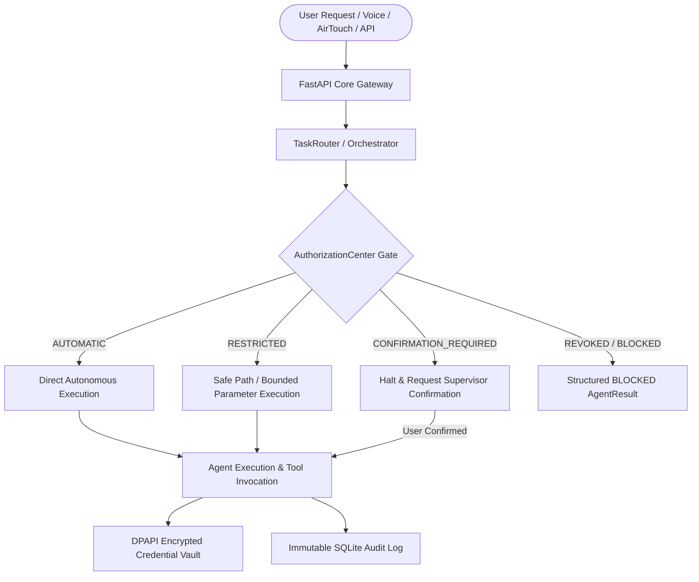

# MATRIX — PRODUCTION PERMISSION MATRIX & AUTHORIZATION SPECIFICATION
**Version:** 3.0.0-PROD  
**Branch:** `final-production-master`  
**Security Standard:** Zero-Implicit Trust / One-Time Authorization Model / Windows DPAPI Enclave  
**Storage Location:** `D:\matrix_data\security\dpapi_vault.dat` & `D:\matrix_data\matrix.db`  

---

## 1. Executive Summary & Architecture Overview

The MATRIX Authorization Center eliminates recurring, disruptive confirmation dialogues during routine operation while strictly bounding autonomous execution. Inspired by autonomous systems, the user authorizes the system once during initial onboarding. Afterward, MATRIX operates autonomously within configured permission profiles, halting for explicit confirmation only on destructive, irreversible, or financially consequential actions.

---

## 2. Autonomy Level Framework

MATRIX enforces five discrete autonomy levels configured via `settings.autonomy_level` and the Desktop HUD:

| Level | Name | Description | Default Profile Mapping |
| :---: | :--- | :--- | :--- |
| **0** | **OBSERVER** | Pure observation & passive telemetry. Zero system state mutation. | Read-only commands only; all writes BLOCKED. |
| **1** | **ASSISTED** | Interactive co-pilot. Requires supervisor confirmation for file writes and app launches. | All writes map to `CONFIRMATION_REQUIRED`. |
| **2** | **BOUNDED AUTONOMY** *(Default)* | Autonomous execution within safe workspace paths (`D:\matrix_data\`, desktop). High-risk operations gated. | Standard matrix: 19 AUTOMATIC, 13 RESTRICTED. |
| **3** | **FULL AUTONOMY** | Autonomous multi-step plan execution, shell execution, web downloads, file operations without prompts. | Destructive system modifications still trigger confirmation guards. |
| **4** | **SYSTEM OVERRIDE** | Emergency diagnostic & repair mode with full hardware and system authority. | Unrestricted execution with comprehensive cryptographic audit logging. |

---

## 3. Comprehensive 32-Scope Production Catalog

All 32 scopes are cataloged, typed, and actively enforced by [`security.permissions.authorization_center`](file:///C:/Users/Ali%20Raza%20Zaidi/Desktop/matrix/security/permissions/authorization_center.py) and [`core.task_router`](file:///C:/Users/Ali%20Raza%20Zaidi/Desktop/matrix/core/task_router.py).

### Category A: Windows 11 Operating System Permissions (12 Scopes)

| # | Scope Identifier | Friendly Name | Default Profile | Enforcement Location | Revocation / Restricted Behavior |
| :-: | :--- | :--- | :-: | :--- | :--- |
| **01** | `microphone` | Audio Capture & Mic | `AUTOMATIC` | `voice/audio/capture.py` | Immediate stream mute; audio buffers zeroed. |
| **02** | `camera` | Integrated Webcam Stream | `RESTRICTED` | `vision/airtouch/hand_tracker.py` | Stream active ONLY when AirTouch mode is explicitly enabled. |
| **03** | `screen_capture` | Desktop Display Capture | `AUTOMATIC` | `agents/computer/agent.py` | Allows screen OCR and multi-modal UI inspection. |
| **04** | `ui_automation` | UI Element Interaction | `AUTOMATIC` | `agents/computer/agent.py` | Programmatic clicking and typing in approved application windows. |
| **05** | `keyboard_mouse` | Virtual Input Synthesis | `AUTOMATIC` | `agents/computer/agent.py` | Synthesizes keystrokes and pointer gestures for PC automation. |
| **06** | `file_folder_access`| Filesystem Read & Write | `RESTRICTED` | `agents/files/agent.py` | Unrestricted in `D:\matrix_data` & workspace; system paths (`C:\Windows`) BLOCKED. |
| **07** | `app_launch` | Software & Browser Launch | `AUTOMATIC` | `agents/computer/agent.py` | Launches registered whitelist applications (`notepad`, `calc`, `chrome`, etc.). |
| **08** | `system_telemetry` | Hardware & CPU Monitoring | `AUTOMATIC` | `agents/system/agent.py` | Unrestricted polling of CPU, RAM, disk, thermal, and network metrics. |
| **09** | `notifications` | Windows Toast Alerts | `AUTOMATIC` | `agents/system/agent.py` | Dispatches native Win11 toast notifications via Powershell / WinRT. |
| **10** | `clipboard_access` | Windows Clipboard Access | `AUTOMATIC` | `agents/computer/agent.py` | Read and write access to Windows system clipboard buffer. |
| **11** | `startup_background_service` | Auto-Start & Background | `AUTOMATIC` | `run_matrix.py` | Background daemon operation and Windows service persistence. |
| **12** | `bluetooth_devices` | BLE & Bluetooth Subsystem | `RESTRICTED` | `core/hardware/bluetooth.py` | Scans BLE beacons; connection to unapproved MAC addresses requires prompt. |

### Category B: Connected Services & Cloud APIs (9 Scopes)

| # | Scope Identifier | Friendly Name | Default Profile | Enforcement Location | Revocation / Restricted Behavior |
| :-: | :--- | :--- | :-: | :--- | :--- |
| **13** | `google_workspace_oauth` | Google Account OAuth | `RESTRICTED` | `core/integrations/google_workspace.py` | Token refresh allowed; scope elevation requires re-consent. |
| **14** | `gmail` | Email Dispatch & Read | `RESTRICTED` | `core/integrations/google_workspace.py` | Read & draft emails automatic; outbound sending to new recipients gated. |
| **15** | `google_calendar` | Calendar Event Scheduling | `AUTOMATIC` | `core/integrations/google_workspace.py` | Querying and booking non-conflicting schedule entries. |
| **16** | `github` | GitHub Developer Access | `RESTRICTED` | `core/integrations/github_connector.py` | Repo read & issue search automatic; git push / PR creation gated. |
| **17** | `telegram` | Telegram Companion Bot | `AUTOMATIC` | `core/integrations/telegram_connector.py` | Relays real-time notifications and commands to/from Telegram bot. |
| **18** | `bland_phone_calling`| Bland AI Telephony | `CONFIRMATION_REQUIRED` | `core/telephony/bland_client.py` | Financial gate. Outbound calling restricted to allowlisted target numbers. |
| **19** | `firebase_notifications` | Push Cloud Messaging | `AUTOMATIC` | `agents/android/agent.py` | Relays notifications to Android companion handsets. |
| **20** | `tailscale_remote_access` | WireGuard Mesh Tunnel | `RESTRICTED` | `core/tailscale_manager.py` | Gated to private 100.64.0.0/10 CGNAT subnet; WAN ingress blocked. |
| **21** | `weather_openmeteo` | Open-Meteo Weather Polling | `AUTOMATIC` | `agents/personal/agent.py` | Unrestricted rate-limited HTTPS queries for live forecasts. |

### Category C: Physical Hardware Subsystems (6 Scopes)

| # | Scope Identifier | Friendly Name | Default Profile | Enforcement Location | Revocation / Restricted Behavior |
| :-: | :--- | :--- | :-: | :--- | :--- |
| **22** | `laptop_microphone` | Laptop Built-in Mic | `AUTOMATIC` | `voice/audio/capture.py` | DirectSound/WASAPI 16kHz capture buffer for wake-word. |
| **23** | `speakers` | Audio Playback & TTS | `AUTOMATIC` | `voice/playback_coordinator.py` | Single-lease playback; prevents dual-audio and overlapping utterances. |
| **24** | `webcam` | SunplusIT Integrated Cam | `RESTRICTED` | `vision/airtouch/hand_tracker.py` | 30 FPS DirectShow pipe; stops when AirTouch toggled OFF. |
| **25** | `android_phone` | Android Handset Link | `AUTOMATIC` | `core/pairing_manager.py` | Cryptographic QR pairing, token TTL enforcement, device unpairing. |
| **26** | `bluetooth_hardware` | Host Bluetooth Controller | `RESTRICTED` | `core/hardware/bluetooth.py` | Requires supervisor authorization before pairing unknown peripherals. |
| **27** | `airtouch_tracking_hardware` | Gesture Engine Sensors | `RESTRICTED` | `vision/airtouch/hand_tracker.py` | Hand & eye tracking CPU execution via MediaPipe tasks. |

### Category D: Repository Adapters & Code Execution (5 Scopes)

| # | Scope Identifier | Friendly Name | Default Profile | Enforcement Location | Revocation / Restricted Behavior |
| :-: | :--- | :--- | :-: | :--- | :--- |
| **28** | `github_starred_repos` | Capability Registry Store | `AUTOMATIC` | `core/capability_registry.py` | Reading 65 registered capability adapters and tool definitions. |
| **29** | `approved_dependency_installation` | Pip Package Management | `RESTRICTED` | `core/runtime/package_manager.py` | Limited to verified dependencies; arbitrary package installation blocked. |
| **30** | `local_model_downloads` | AI Model Weight Retrieval | `AUTOMATIC` | `core/model_manager.py` | Downloading validated GGUF, ONNX, and MediaPipe model files. |
| **31** | `tool_registration` | Dynamic Tool Registration | `AUTOMATIC` | `core/tool_adapters/manager.py` | Dynamic loading of verified tool adapters into agent registry. |
| **32** | `isolated_execution_environments`| Sandboxed Execution Run | `RESTRICTED` | `agents/code/agent.py` | Sandboxed Python/PowerShell execution with timeout guards and AST filters. |

---

## 4. Enforcement Lifecycle & Revocation Guarantee

When a scope profile is altered or revoked:
1. **Immediate In-Memory Update:** The `AuthorizationCenter` updates the active scope state in real-time.
2. **Persistent Database Sync:** The change is committed to `D:\matrix_data\matrix.db` in the `capabilities` and `audit_logs` tables.
3. **TaskRouter Ingress Gate:** Any subsequent agent action mapping to that scope is checked before execution. If revoked or if profile is `CONFIRMATION_REQUIRED` without explicit approval, `TaskRouter.dispatch` returns an immediate `BLOCKED` status without invoking the agent or tool.
4. **Active Subsystem Shutdown:** For streaming hardware scopes (such as `camera` or `microphone`), revocation signals the background worker thread to stop capture and close DirectShow / audio device handles.

---

## 5. DPAPI Credential Vault Security Model

All sensitive secrets, keys, and tokens are encrypted using the Windows Data Protection API (`win32crypt.CryptProtectData`):
- **Cipher:** CryptProtectData with current Windows user SID and optional machine entropy.
- **Zero Plaintext on Disk:** Vault file `D:\matrix_data\security\dpapi_vault.dat` contains only encrypted ciphertext blobs.
- **Auto-Redaction:** Memory and logging layers automatically sanitize patterns matching API keys (`AIza...`, `sk-...`, `ghp_...`, `Bearer ...`).
- **REST Management Endpoints:**
  - `GET /api/v1/security/vault/catalog`: Returns masked secret catalog (e.g. `org_6c8...2969`).
  - `POST /api/v1/security/vault/secret`: Stores and encrypts a secret key-value pair.
  - `DELETE /api/v1/security/vault/secret/{key}`: Purges a secret key from the encrypted vault.
