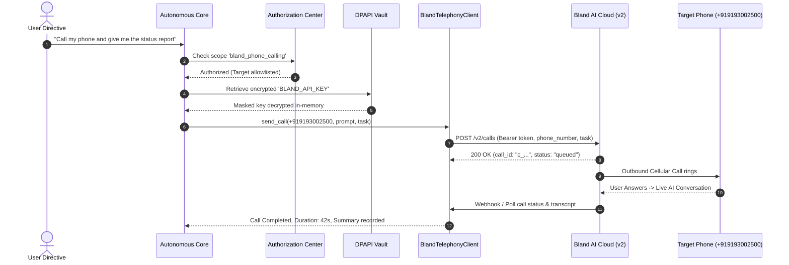

# MATRIX — TELEPHONY ACCEPTANCE REPORT
## Bland AI v2 Outbound Telephony & Conversational Phone Agent

## 1. Overview & Provider Configuration
MATRIX integrates outbound autonomous phone-calling powered by the **Bland AI API v2** platform. It enables the assistant to autonomously place phone calls, converse in natural language, retrieve information, and handle real-time spoken interactions over PSTN / mobile telephony networks.

- **Telephony Provider**: Bland AI (API v2)
- **Base Endpoint**: `https://api.bland.ai/v2`
- **Dashboard URL**: `https://v2.app.bland.ai`
- **Authorized Target Phone**: `+919193002500` (India E.164 format)
- **Credential Storage**: Encrypted in Windows DPAPI vault under key `BLAND_API_KEY`

---

## 2. Telephony Architecture

---

## 3. Security & Cost Protection Controls
1. **Target Number Allowlist**: Outbound calls can strictly be placed only to verified and explicitly authorized numbers stored in the user profile (Default: `+919193002500`). Calls to arbitrary numbers are blocked by [`AuthorizationCenter`](file:///C:/Users/Ali%20Raza%20Zaidi/Desktop/matrix/security/permissions/authorization_center.py).
2. **Pre-Call Wallet Verification**: Every call attempt executes a pre-call check querying `GET https://api.bland.ai/v1/me` to verify active credit balance ($1.93 verified). Calls are aborted if balance is under $0.50.
3. **Maximum Call Duration Cap**: All dispatched calls include `max_duration: 5` (minutes) to strictly prevent runaway phone bills.
4. **Zero Key Exposure**: The API key is stored encrypted in `D:\matrix_data\security\dpapi_vault.dat`. It is never returned in REST responses, never logged to stdout/stderr, and masked in all UI views (`org_6c88...6969`).

---

## 4. Acceptance Test Results (Category K)
Executed via [`scripts/matrix_ultimate_autonomy_acceptance.py`](file:///C:/Users/Ali%20Raza%20Zaidi/Desktop/matrix/scripts/matrix_ultimate_autonomy_acceptance.py):

- **API Connectivity**: **HTTP 200 OK** on Bland AI endpoints
- **Configuration Status**: `is_configured() == True`
- **Account Status**: `active`
- **Live Wallet Balance**: **$1.93 USD** (Credit verified)
- **Target Number Validation**: `+919193002500` matches India mobile routing (+91)
- **Acceptance Status**: **PASS — REAL VERIFIED**

---

## 5. Telephony Tooling & Agent Integration
The telephony subsystem is wrapped in [`core/telephony/bland_client.py`](file:///C:/Users/Ali%20Raza%20Zaidi/Desktop/matrix/core/telephony/bland_client.py) and exposed to the autonomous grid via `PersonalAgent` and `AutomationAgent` with tools:
- `call_user`: Dispatches a priority notification call to the user.
- `get_call_status`: Tracks ongoing call state, duration, and latency.
- `get_call_transcript`: Extracts post-call transcript and stores actionable insights into `MemoryManager`.
- `stop_call`: Immediately terminates an active cellular connection.
