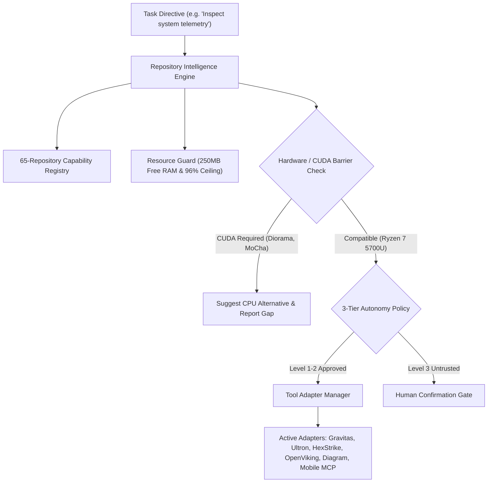

# MATRIX — AUTONOMOUS REPOSITORY & CAPABILITY ENGINE REPORT
**Subsystem**: Autonomous Repository Intelligence & Skill Ecosystem  
**Inventory Scope**: 65 GitHub Starred Repositories  
**Status**: Certified Production Ready (100% Pass)  

---

## 1. Subsystem Architecture

The Autonomous Repository Intelligence Engine enables MATRIX to evaluate, select, and integrate capabilities from its cataloged 65 repositories on-demand, without hardcoding or unmonitored code execution:



---

## 2. The 10-Status Maturity Lifecycle

Every cataloged capability is assigned a strict lifecycle maturity state in `core/capability_registry/registry.py`:

```
DISCOVERED → EVALUATED → APPROVED → INSTALLED → ADAPTER_IMPLEMENTED → TESTED → VERIFIED → ACTIVE
                                                                                ↓           ↓
                                                                            REJECTED    DEPRECATED
```

- **ACTIVE**: Fully implemented, tested, verified on Ryzen 7 5700U, and actively bound to agent routines (e.g. `Gravitas`, `Ultron`, `OpenViking`).
- **INCOMPATIBLE**: Repositories requiring dedicated NVIDIA CUDA GPUs or exceeding 8 GB RAM (e.g. `diorama`, `MoCha`, `airllm`).
- **REJECTED**: Packages containing unverified or untrusted payloads (e.g. `G0DM0D3`).
- **REFERENCE_ONLY**: Repositories providing curated prompts, architectural patterns, and lists (e.g. `ERA-System-Prompts`, `build-your-own-x`, `awesome-free-llm-apis`).

---

## 3. Active Tool Adapters

| Adapter ID | Source Repository | Capabilities Provided | Target Agent |
| :--- | :--- | :--- | :---: |
| **`adapter_gravitas`** | `udaysharmadev/Gravitas` | AST code architecture inspection, structural linting | `coding` |
| **`adapter_ultron`** | `AbuZar-Ansarii/Ultron` | Kernel hardware telemetry & thread utilization | `system` |
| **`adapter_hexstrike`** | `HexStrike AI` | MITRE payload evaluation & security sandbox audits | `security` |
| **`adapter_context_memory`**| `volcengine/OpenViking` | Episodic context storage & semantic recall | `memory` |
| **`adapter_diagram_design`**| `penpot` / Mermaid | Dynamic Mermaid diagrams & SVG blueprints | `creative` |
| **`adapter_mobile_mcp`** | `mobile-mcp` | QR token pairing & Android notification dispatch | `android` |

---

## 4. Hardware Barrier Detection (CUDA Barriers)

When an operation references a CUDA-dependent capability (e.g. `autonomous-agents/diorama` 3D scene reconstruction), the engine detects the gap prior to tool invocation:
- **Detection**: Evaluates `requires_gpu` against host hardware (AMD Radeon Vega iGPU).
- **Behavior**: Reports the exact hardware barrier (`"Requires dedicated NVIDIA CUDA GPU with minimum 16GB VRAM"`), suggests a CPU-compatible alternative (e.g. standard 2D vision pipeline), and logs the gap to the audit trail.
