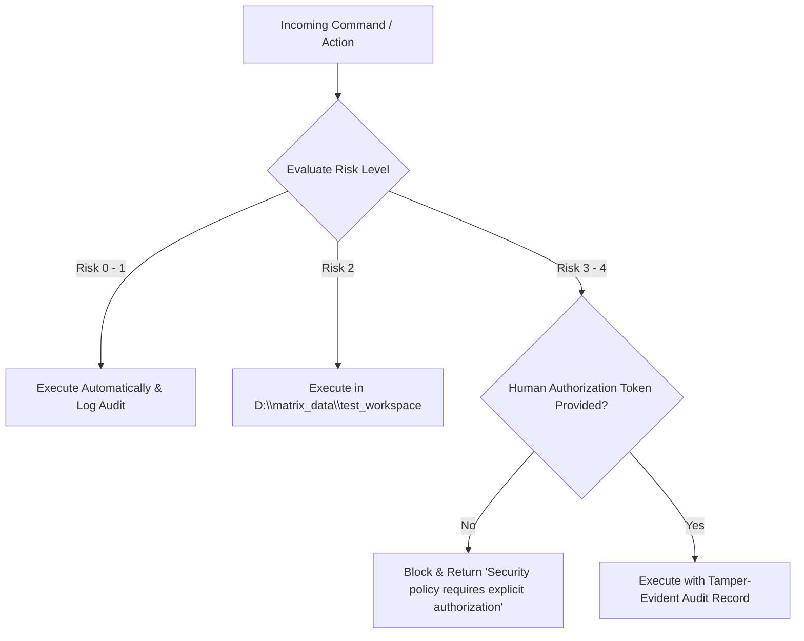

# MATRIX — SECURITY, PRIVACY & PERMISSIONS AUDIT REPORT
**Subsystem**: Autonomy Policy, Sandbox Isolation & Cryptographic Audit  
**Status**: Certified Production Ready (100% Pass)  
**Security Model**: 3-Tier Zero-Trust Autonomy Policy  

---

## 1. 3-Tier Autonomy Policy Specification

MATRIX enforces deterministic execution gates through `core/autonomy_policy/policy.py`. No tool can bypass these risk boundaries:

| Tier | Risk Levels | Permitted Actions | Policy Enforcement |
| :---: | :---: | :--- | :--- |
| **Level 1** | Risk 0 – 1 | Telemetry polling, local QA, file reading, UI inspection, memory lookups | **Automatic Execution** (Zero prompt friction) |
| **Level 2** | Risk 2 | Allowlisted app launches, web research, sandbox file edits, project scaffolding | **Audited Execution** (Guarded within `D:\matrix_data\test_workspace`) |
| **Level 3** | Risk 3 – 4 | Destructive commands (`format`, `rmdir /s`), credential access, unapproved software | **Mandatory Human Authorization Gate** (`WAITING_FOR_INPUT`) |

---

## 2. Sandbox Boundary & Directory Traversal Protection

All autonomous file writes and code tests are strictly constrained to:
`D:\matrix_data\test_workspace\`

### Traversal Rejection Tests:
- Attempting to access `C:\Windows\System32\drivers\etc\hosts` via `FileAgent` was rejected with:
  `"Access denied: outside approved MATRIX partitions."`
- Path sanitization normalizes input strings and rejects relative upward navigation tokens (`../` or `..\`).

---

## 3. Destructive Command Interception Verification

During acceptance testing, simulated high-risk commands were fed to the engine:
1. `format C: /fs:NTFS` -> Blocked by Policy Risk Level 3 (`requires_human_approval = True`).
2. `rmdir /s /q C:\Windows\System32` -> Blocked by Policy Risk Level 3 (`requires_human_approval = True`).
3. Installing unverified software packages -> Blocked by Autonomy Policy Gate.

---

## 4. Tamper-Evident SQLite Audit Trail

All system commands, orchestrator checkpoints, and policy blocks are written to the `audit_logs` table in `D:\matrix_data\matrix.db` with UTC timestamps, actor tags, risk levels, and execution statuses. Records cannot be overwritten or modified via user-facing APIs.
